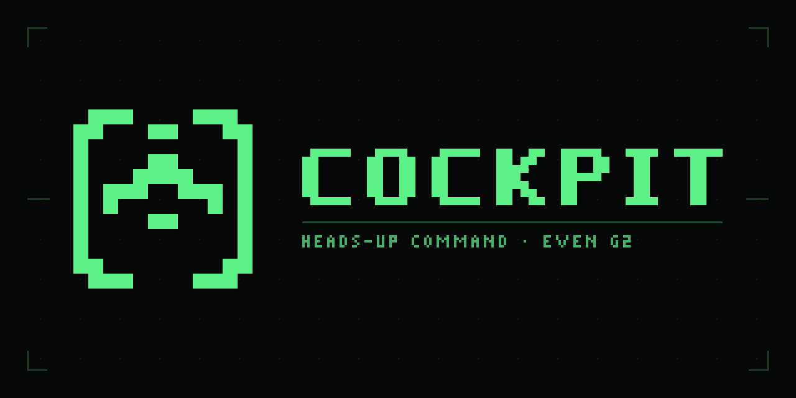

# Cockpit — Heads-Up Command Centre for Even G2

> **“Logged, logged — LLM worker.”**
> One universal hold-to-speak gesture across **Work**, **Personal**, and **Interests** on Even Realities G2 smart glasses (`576 × 288` monochrome green). **Jev** (System 1 on OpenRouter, `~220 ms` triage) decides whether to stage a quick log for **Notion** (with optional async enrichment behind the scenes) or wake the **System-2** worker for sourced earnings research — returning **one calm, verifiable card** at a glance.

Built for **[Heads Up: Even Realities Hackathon](https://dorahacks.io/hackathon/even-realities/detail)** (Nov 23–29, 2026) — **Track 04 · AI Assistants & Work** (`OpenRouter` + `Notion`).

---

## Why Cockpit?

Most smart-glasses assistants treat *"Remember to buy a birthday present"* the same as *"Did NVIDIA's margin thesis break?"* — sending every fleeting thought to a slow, chatty LLM that dumps paragraphs onto a narrow monochrome lens.

Cockpit pairs a **calm default `HOME` screen** (`COCKPIT | READY`) with a **three-tier compute hierarchy**:

| Utterance (Hold temple / ring / mic) | Tier & Jev Decision (`~220 ms`) | On-Lens LLM? | What Happens on G2 + Notion |
| :--- | :--- | :--- | :--- |
| *"Remember to buy a birthday present"* | **Tier 1** · `Personal · LOG_TASK` (`enrich: no`) | **No** | Instant `CONFIRM` card → **1 tap** logs to SQLite + Notion `Cockpit Log` (`~$0.000057` Jev triage) |
| *"I enjoyed the latest Acquired podcast"* | **Tier 1 → Async Tier 2** · `Interests · LOG_NOTE` (`enrich: yes`) | **No** *(async)* | Instant `CONFIRM` → `SAVED`; background worker resolves the latest episode + provider-cited link and patches Notion in place (never guesses unnamed shows → `Needs Detail`) |
| *"Preview NVIDIA before earnings"* | **Tier 0** · `Work · EARNINGS_PREVIEW` (tracked) | **No** | Local render `< 5 ms` from SQLite (`Saved Question`, prior baseline, open `Next Check`); zero LLM call *(spoken flow still includes STT + Jev + optional Notion pull)* |
| *"Can you please preview Alphabet earnings?"* | **Tier 1 + Tier 2 Web** · `Work · EARNINGS_PREVIEW` (any company) | **Yes** *(web)* | Works **held or not held** — date-aware OpenRouter web preview (`PREVIEW \| GOOGL \| WEB`) + stageable watchpoint |
| *"Can we review NVIDIA earnings?"* | **Tier 1 + Tier 2** · `Work · BRIEF_HOLDING` | **Yes** | Pulls latest Notion question first, checks real Q3 FY27 filing via FTS5 + Jev, renders **1 sourced delta card** (`HELD` / `AHEAD` / `WATCH`) |
| *"What's the read-across from TSMC to NVIDIA?"* | **Tier 1 + Tier 2** · `Work · PEER_READ_ACROSS` | **Yes** | Connects real Oct 2026 TSMC Q3 evidence to NVIDIA's thesis + proposes a 2-tap verified `Next Check` |

### Measured Latency: Local Compute vs. End-to-End Live
We report local compute and network-bound end-to-end timings separately (details in [docs/live-wiring-learnings.md](docs/live-wiring-learnings.md)):
- **Local compute (Tier 0):** SQLite FTS5 retrieval and tracked `earnings_preview` card formatting run in **`< 5 ms`** (`$0`).
- **System-1 routing (Tier 1):** OpenRouter Jev (`~typesafe/jev-latest`) averages **`~210–315 ms`** warm (`~$0.000057`/call).
- **Spoken end-to-end (live):** Voice utterances add OpenRouter Whisper STT (`~1.6–2.2 s`) before Jev routing; live tracked previews/briefings also await a Notion watchlist pull, and live `SAVED` receipts await the Notion page write before updating the HUD.
- **System-2 synthesis (Tier 2):** DeepSeek V4.1 Flash runs in `~2.2 s` for indexed filing synthesis (`~10 s` with live OpenRouter web search for ad-hoc non-held companies or async background enrichment, where background enrichment never blocks the `SAVED` confirmation).

---

## Signature Work Demo: “One Release, Two Different Glances”

Cockpit indexes real Oct–Nov 2026 primary issuer filings for three sample watchlist holdings (**NVDA**, **MSFT**, **TSM**) — strictly read-only. Changing the single `Saved Question` on a Notion watchlist row changes the first card you see from the exact same release:

| `Saved Question` in Notion (`NVDA`) | What the wearer sees on G2 (`576 × 288`) |
| :--- | :--- |
| *“Does NVIDIA expect the margin trough to get deeper?”* | `Q4 FY27 gross margin guide \| 71–72%. Management had already flagged that range in August.` `[Q3 FY27 PR · Nov 17]` |
| *“Is revenue running ahead of management's guidance?”* | `Q3 FY27 revenue \| $115.8bn. About 7% above the company's $108bn guidance midpoint.` `[Q3 FY27 PR · Nov 17]` |

- **Follow-up retrieval + honest abstention:** Ask *"What did management expect to bring margins back up?"* to retrieve the August FY27 call (`p. 7`, Q1 FY28 price increases). Ask an unsupported question such as *"What did management say about NVIDIA warranty reserves?"* (or set NVDA's `Saved Question` to *"Warranty reserves?"*) to see Cockpit honestly return **`No matching passage`** instead of hallucinating.
- **Zero-surprise human-in-the-loop controls:**
  - **2-tap preview before save:** AI-drafted checks are never written unseen — tap once to inspect exact wording on `CONFIRM CHECK`, tap again to save.
  - **Fix misclassifications on the glasses:** On any `CONFIRM` card, **`Swipe`** cycles destination in place (`Interests Note` ↔ `Personal Task` ↔ `Work Check`) without re-speaking; **`Double-tap`** discards.
  - **Stay-until-tap receipt + Undo (with partial-failure transparency):** After saving, the `SAVED` card stays on screen until you **`Tap`** back to calm `HOME` (or **`Swipe`** to **Undo**). SQLite commits first and Notion create / watchlist PATCH / archive run as independent API calls: if Notion is unreachable, the HUD shows `Saved to Journal.` (local-only), and Undo removes the SQLite row locally (`Removed from Journal.`) while any already-synced Notion row or remote `Next Check` may remain until Notion is reachable.
  - **Enrichment privacy & citation guard:** When Jev flags a confirmed Personal/Interests note for live background enrichment, the full confirmed note text is sent to OpenRouter's web-enabled model (`deepseek/deepseek-v4.1-flash-1017` + `web` plugin). Only URLs matching OpenRouter's provider `url_citation` annotations are published as clickable links; unverified model-invented links are dropped.

---

## Architecture

```text
Even G2 Glasses / Even Hub Simulator (576x288 monochrome green, 16 kHz CoreAudio PCM mic)
        │  @evenrealities/even_hub_sdk (0.0.16)
        ▼
glasses/ (Vite + TypeScript plugin · 3 fixed LVGL text containers · serialized upgrades)
        │  HTTP (JSON + 16 kHz RIFF/WAV -> local loopback 127.0.0.1:8000)
        ▼
backend/ (Python 3.13 · FastAPI · SQLite + FTS5 · Async Enrichment & Recompute Queues)
   ├── OpenRouter STT          POST /api/v1/audio/transcriptions  (openai/whisper-large-v3-turbo)
   ├── OpenRouter Jev          POST /api/alpha/decisions          (~typesafe/jev-latest, ~220 ms)
   ├── OpenRouter Synthesis    POST /api/v1/chat/completions      (deepseek/deepseek-v4.1-flash-1017 + web plugin)
   └── Notion API              Live 2-way sync (Cockpit Log w/ enrichment + Holdings Watchlist)
```

- **Technical architecture, G2 gesture map & Notion schema:** [docs/architecture.md](docs/architecture.md)
- **≤3-minute split-screen demo storyboard & 5 API feature requests:** [docs/demo-script.md](docs/demo-script.md)
- **Live OpenRouter, Jev, Notion & Even Hub Simulator learnings:** [docs/live-wiring-learnings.md](docs/live-wiring-learnings.md)

---

## Quickstart

### Prerequisites
- **Python 3.11+** (tested on Python 3.13)
- **Node.js 22 LTS** (`>=22.18`, tested on `22.23.5` for strict CLI engine checks and `--experimental-strip-types`; also runs on Node `23.1.0`)
- `@evenrealities/evenhub-simulator` (`0.9.5`) and `@evenrealities/evenhub-cli` (`0.1.14`) are installed cleanly from the lockfile via `make setup` (`npm ci`).

### 1. Install Dependencies
```bash
make setup
```

### 2. Configure Environment (Offline Mock Mode or Live OpenRouter + Notion)
```bash
cp .env.example .env
```
- **Zero-key mock mode (default, `COCKPIT_MOCK_MODE=true`):** Runs the full vertical slice locally (deterministic router, FTS5 retrieval, local enrichment stubs, SQLite journal, and Even Hub Simulator) with no API keys.
  - *Evaluator note for mock mode:* Use the **companion text box and quick demo buttons** to test different utterances (in mock mode, microphone clips always transcribe to `"Can we review NVIDIA earnings?"`). To test abstention from `HOME`, type `"What did management say about NVIDIA warranty reserves?"` — Cockpit returns `WORK | NVDA | NO MATCH`.
- **Live OpenRouter + Notion mode:**
  1. Set `COCKPIT_MOCK_MODE=false` and add `OPENROUTER_API_KEY`.
  2. Create an internal Notion integration, share a blank Notion page with it, set `NOTION_TOKEN` + `NOTION_PARENT_PAGE_ID` in `.env`, and run:
     ```bash
     make setup-notion
     ```
     This auto-creates **`Cockpit Log`** (with `Enrichment`, `Enriched`, `Due Date`, `Link`) and **`Holdings Watchlist`** (seeded with `NVDA`, `MSFT`, `TSM`) and writes their database IDs into `.env`.
  3. Run the read-only live connectivity check (verifies OpenRouter Jev, DeepSeek, Whisper STT, and Notion `pull_holdings`; exits non-zero if no live providers are configured; pass `--write` via `PYTHONPATH=backend backend/.venv/bin/python -m app.scripts.smoke_live --write` to also test appending a row to `Cockpit Log`):
     ```bash
     make smoke-live
     ```
  *(Never commit `.env` or `backend/data/cockpit.db` — both are gitignored.)*

### 3. Run the Test Suite & Build
```bash
make test       # 32 Python pytest tests + 14 TypeScript Node tests
make build      # tsc --noEmit && vite build
```

### 4. Launch Backend, Glasses App, and Even Hub Simulator
In three terminals:
```bash
# Terminal 1 — FastAPI backend (http://127.0.0.1:8000)
make backend

# Terminal 2 — Even G2 TypeScript companion & HUD app (http://127.0.0.1:5173)
make glasses

# Terminal 3 — Even Hub G2 Simulator (576x288 LVGL display + native CoreAudio mic)
make sim
```

### 5. Build the Desktop / Simulator `.ehpk` Package
```bash
make pack
```
Produces `glasses/cockpit.ehpk` (`min_app_version 2.2.10`, stamped against SDK `0.0.16`, declaring both `network` and `g2-microphone` permissions in [glasses/app.json](glasses/app.json)).

> **Desktop vs. physical phone deployment note:** The included `make pack` build targets the local desktop FastAPI service at `http://127.0.0.1:8000` (unauthenticated loopback for local simulator development). Distributing an `.ehpk` to a physical phone WebView requires pointing `glasses/src/api.ts` and the `network` whitelist in `glasses/app.json` to a reachable **HTTPS backend with authentication** (since the loopback API intentionally omits auth for local development).

---

## Safety, Provenance & Hackathon Disclosures

- **Read-only financial data:** Cockpit never holds funds, places trades, connects to brokerage execution, or offers investment advice. All financial documents and web lookups are strictly read-only; confirmed writes go exclusively to the user's personal Notion/SQLite journal.
- **Build window:** All code, automated tests, brand assets, Even Hub packaging, and live OpenRouter/Notion integrations in this repository were built during the **Nov 23–29, 2026** hackathon build window.
- **AI-assisted development disclosure:** Built solo with AI-assisted coding tools (disclosed per hackathon organizer guidelines).
- **API feature requests (5):** Documented in [docs/demo-script.md](docs/demo-script.md).
