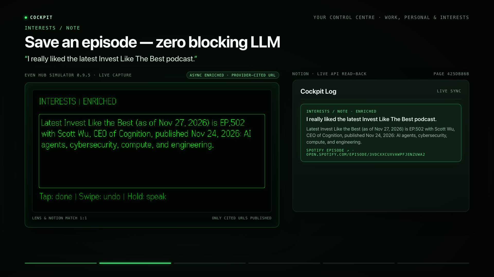
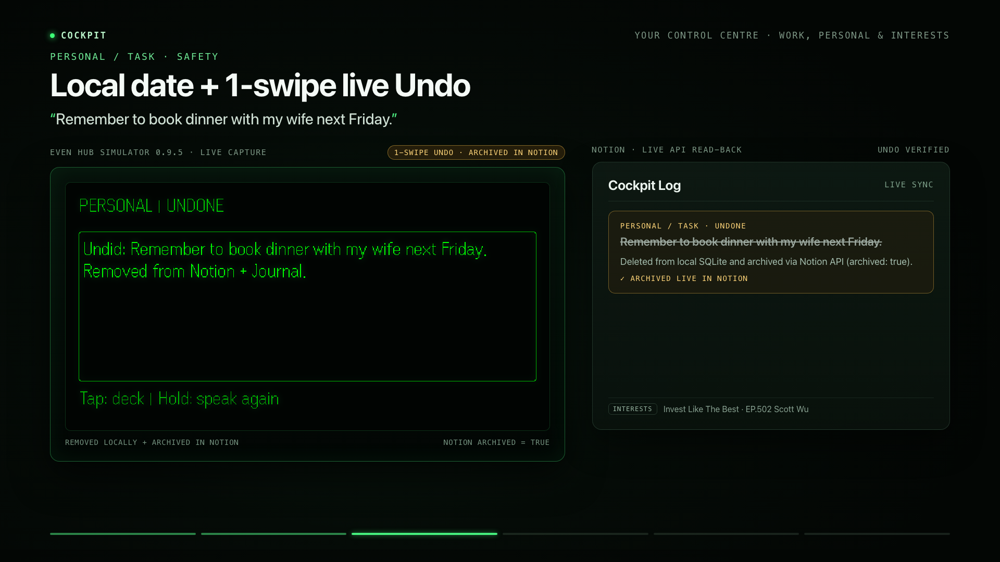
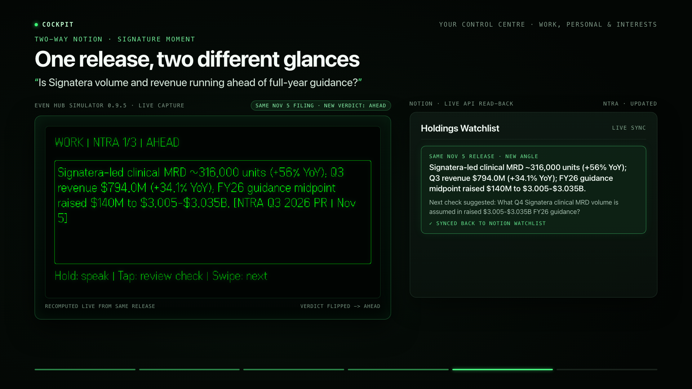
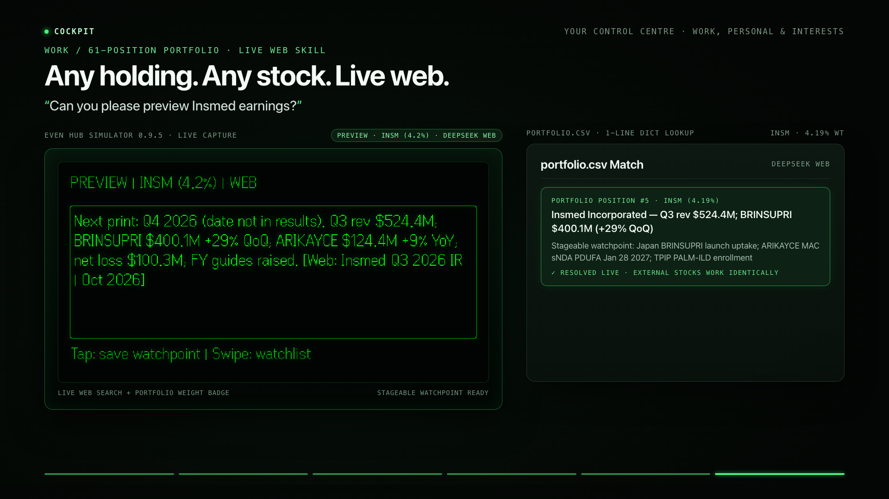

[](https://www.youtube.com/watch?v=ISgrmFkWsOQ)

# Cockpit G2 — The Control Centre for your second Brain

One calm hold-to-speak gesture across **Work**, **Personal**, and **Interests** on **Even Realities G2** (`576 × 288` monochrome green). **OpenRouter Jev** (System 1, `~200–460 ms`) routes quick thoughts straight to **Notion** without stalling on an LLM, and wakes **DeepSeek** (System 2) only when you need sourced research or background enrichment — returning **one calm, verifiable card** at a glance.

**▶ [Watch the Live Demo (2:04)](https://www.youtube.com/watch?v=ISgrmFkWsOQ)** · Built for **[Heads Up: Even Realities Hackathon](https://dorahacks.io/hackathon/even-realities/detail)** (Nov 23–29, 2026) — **Track 04 · AI Assistants & Work** (`OpenRouter` + `Notion`).

### Live Captures (`Even Hub Simulator 0.9.5` + OpenRouter Jev / DeepSeek + Two-Way Notion)

| Fast Path + Async Enrichment | Local Date + 1-Swipe Live Undo |
| :---: | :---: |
|  |  |
| **Two-Way Notion: One Release, Two Glances** | **Zero Hardcoded Tickers: CSV + Live Web** |
|  |  |

---

## Why Cockpit G2?

Most smart-glasses assistants treat *"Book dinner next Friday"* the same as *"What changed in my biggest position's earnings?"* — stalling on a slow LLM for every utterance and dumping walls of chat onto a tiny green lens.

Cockpit G2 boots into a calm `COCKPIT | READY` screen and splits every voice command across **three compute tiers**:

| Utterance (Hold temple / ring / mic) | Tier & Live Jev Route | Blocking LLM? | Result on G2 + Live Notion |
| :--- | :--- | :---: | :--- |
| *"I really liked the latest Invest Like The Best podcast."* | **Tier 1 → Async Tier 2** · `Interests` (`~460 ms`) | **No** *(async)* | Instant `CONFIRM` → 1 tap logs to Notion; background worker resolves **EP.502 (Scott Wu)** + provider-cited Spotify link in place |
| *"Remember to book dinner with my wife next Friday."* | **Tier 1** · `Personal` (`~260 ms`) | **No** | Resolves `Fri 4 Dec 2026` locally (zero LLM) and saves to Notion; **1 swipe** on `SAVED` deletes locally & archives the row live (`archived: true`) |
| *"Can we review Natera earnings?"* | **Tier 1 + Tier 2** · `Work · Brief` (`~200 ms`) | **Yes** | Pulls your latest Notion `Saved Question`, checks indexed Q3 filings via FTS5 + Jev, renders **1 sourced card** (`HELD` / `AHEAD` / `WATCH`) |
| *"What drove Signatera ASP and cash flow?"* | **Tier 1 + Tier 2** · `Work · Follow-Up` (`~205 ms`) | **Yes** | Retrieves the exact call passage (`~$1,290 ASP; cash $1.10B, FCF-positive`); **Tap 1** previews exact check wording, **Tap 2** writes to Notion |
| *"Can you please preview Insmed earnings?"* | **Tier 1 + Tier 2 Web** · `Work · Preview` (`~200 ms`) | **Yes** *(web)* | **Zero hardcoded tickers:** routes directly to live web search, resolves `INSM`, and tags weight (`4.2%`) from a drop-in CSV — any public stock works |

> **Example Work Domain:** The **Work** mind ships configured as a strictly read-only equity research workflow to prove real-world density — including a **sample CSV watchlist** ([backend/app/data/portfolio.csv](backend/app/data/portfolio.csv)) and three indexed Oct–Nov 2026 primary releases ([Natera Q3](https://investor.natera.com/news-releases/news-release-details/natera-reports-third-quarter-2026-financial-results), [Seagate Q1 FY27](https://investors.seagate.com/news/news-details/2026/Seagate-Technology-Reports-Fiscal-First-Quarter-2027-Financial-Results/default.aspx), [Amazon Q3](https://ir.aboutamazon.com/news-release/news-release-details/2026/Amazon-com-Announces-Third-Quarter-Results/default.aspx)). Swap in your own CSV or edit your Notion watchlist to adapt it with zero code changes.

---

## Signature Moment: “One Release, Two Glances”

Edit a single `Saved Question` cell directly in Notion and pull to the glasses — the **exact same Nov 5 Natera Q3 filing** flips the G2 card on demand:

| `Saved Question` in Notion (`NTRA`) | What appears on Even G2 (`576 × 288`) |
| :--- | :--- |
| *“Is Natera's underlying gross margin expanding without revenue true-ups?”* | `Underlying non-GAAP gross margin ex-true-ups 63.2% (+140 bps QoQ); true-ups fell to $32.3M vs $52.3M.` `[NTRA Q3 2026 PR · Nov 5]` |
| *“Is Signatera volume and revenue running ahead of full-year guidance?”* | `Signatera-led clinical MRD ~316,000 units (+56% YoY); Q3 rev $794.0M (+34.1% YoY); FY26 guide raised $140M.` `[NTRA Q3 2026 PR · Nov 5]` |

- **Honest abstention:** Ask something unsupported by the filing (e.g., *"What did management say about Natera warranty reserves?"*) and Cockpit returns **`WORK | NTRA | NO MATCH`** instead of guessing.
- **Human-confirmed writes only:** AI never writes unseen — **1 tap** confirms fast Personal/Interests saves (with **Swipe** to switch destination in place), **2 taps** preview and commit Work checks, and **1 swipe** on `SAVED` triggers live Undo.
- **Verified provenance:** Background enrichment only attaches links verified in OpenRouter provider `url_citation` annotations; local SQLite commits first and HUD receipts distinguish `Saved to Notion + Journal.` vs. local-only `Saved to Journal.`.

---

## Architecture & Performance

```text
Even G2 Glasses / Even Hub Simulator 0.9.5 (576×288 green HUD, 16 kHz CoreAudio PCM mic)
        │  @evenrealities/even_hub_sdk (0.0.16)
        ▼
glasses/ (Vite + TypeScript · 3 fixed LVGL containers · serialized HUD upgrades)
        │  HTTP (JSON + 16 kHz RIFF/WAV -> local loopback 127.0.0.1:8000)
        ▼
backend/ (Python 3.13 · FastAPI · SQLite + FTS5 · Drop-in CSV Registry · Async Workers)
   ├── OpenRouter STT          openai/whisper-large-v3-turbo     (~1.6–2.2 s spoken transcription)
   ├── OpenRouter Jev          ~typesafe/jev-latest              (~200–460 ms, ~$0.00006/call)
   ├── OpenRouter Synthesis    deepseek/deepseek-v4.1-flash-1017 (~2.2 s indexed / ~10 s live web)
   └── Live Two-Way Notion     Cockpit Log (writes, async enrichment, Undo) & Holdings Watchlist
```

- **Tier 0 (local):** SQLite FTS5 retrieval & indexed previews render in **`< 5 ms`** (`$0`).
- **Verification:** **51 automated tests** (`37` Python + `14` TypeScript) and **`15/15` live OpenRouter + Notion smoke checks**.
- **Deep dives:** [Architecture & Gestures](docs/architecture.md) · [Live Wiring Learnings & 5 API Requests](docs/live-wiring-learnings.md)

---

## Quickstart

**Prerequisites:** Python `3.11+` (tested on `3.13`) and Node.js `22 LTS` (`>=22.18`). `make setup` installs `@evenrealities/evenhub-simulator` (`0.9.5`) and `@evenrealities/evenhub-cli` (`0.1.14`) from the lockfile.

```bash
make setup
cp .env.example .env
```

- **Zero-key mock mode (default, `COCKPIT_MOCK_MODE=true`):** Runs the entire vertical slice offline with no API keys. Use the companion text box or quick demo buttons to test different utterances (mock mic input defaults to Natera review).
- **Live OpenRouter + Notion mode:** Set `COCKPIT_MOCK_MODE=false`, add `OPENROUTER_API_KEY`, `NOTION_TOKEN`, and a shared `NOTION_PARENT_PAGE_ID` in `.env`, then run:
  ```bash
  make setup-notion   # Auto-creates Cockpit Log & Holdings Watchlist and writes DB IDs to .env
  make smoke-live     # Verifies live OpenRouter Jev, DeepSeek, Whisper STT & Notion read-back
  ```
  *(Never commit `.env` or `backend/data/cockpit.db` — both are gitignored.)*

### Test, Build & Run

```bash
make test           # 37 Python pytest tests + 14 TypeScript Node tests
make build          # tsc --noEmit && vite build
```

Launch in three terminals:

```bash
make backend        # Terminal 1 — FastAPI backend (http://127.0.0.1:8000)
make glasses        # Terminal 2 — Even G2 companion & HUD app (http://127.0.0.1:5173)
make sim            # Terminal 3 — Even Hub G2 Simulator (576×288 + CoreAudio mic)
```

### Package `.ehpk`

```bash
make pack           # Builds glasses/cockpit.ehpk (min_app_version 2.2.10, SDK 0.0.16, network + g2-microphone)
```

Or download the pre-built desktop simulator package (`cockpit.ehpk`) directly from **[GitHub Releases](https://github.com/oblomovunleashed/Cockpit-G2/releases/latest)**.

> **Desktop vs. phone deployment:** `make pack` (and the release `.ehpk`) targets the unauthenticated local desktop loopback (`http://127.0.0.1:8000`) for simulator evaluation. Deploying to a physical phone WebView requires pointing `glasses/src/api.ts` and `glasses/app.json` to an authenticated HTTPS backend.

---

## Safety & Disclosures

- **Strictly read-only financial inputs:** No brokerage execution, trading, or investment advice. Confirmed writes go exclusively to your personal SQLite journal and Notion workspace.
- **Hackathon build window:** All code, tests, brand assets, `.ehpk` packaging, and live integrations were built during **Nov 23–29, 2026** (built solo with AI-assisted coding tools).
- **API & SDK feature requests (5):** Documented in [docs/live-wiring-learnings.md](docs/live-wiring-learnings.md#5-api--sdk-feature-requests-5--collected-during-build-week).
